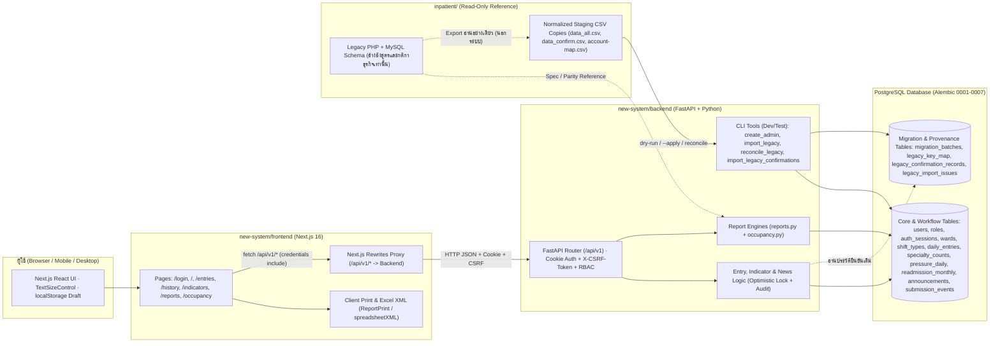
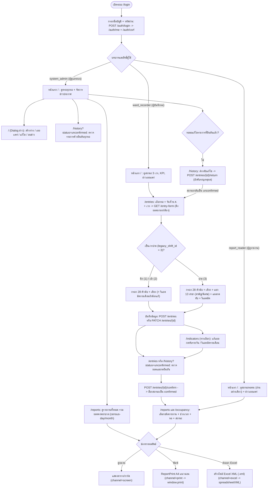
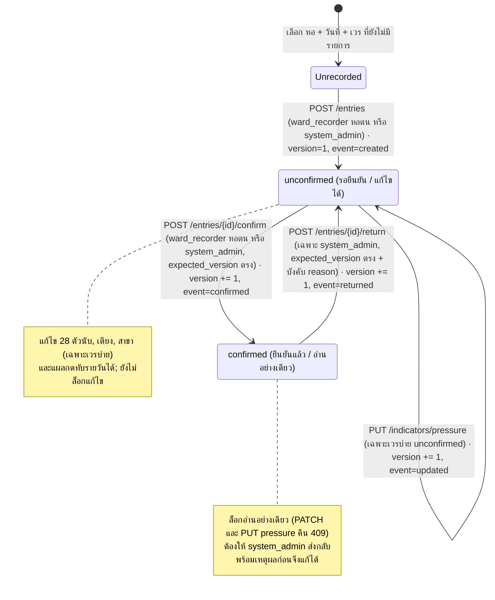
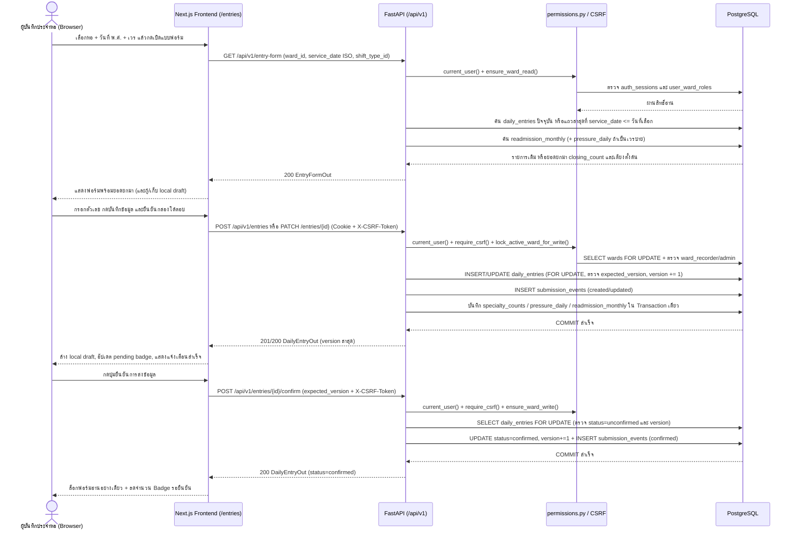
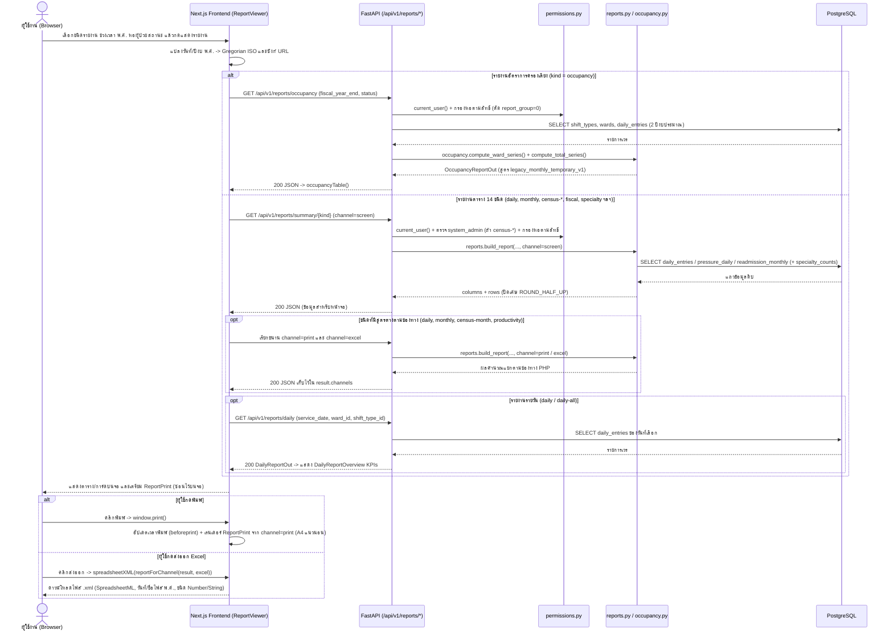

# สถาปัตยกรรมระบบ ลำดับการทำงาน และแผนภาพ Flow (System Architecture & End-to-End Flow)

> **ขอบเขตเอกสาร:** สรุปจากการตรวจสอบซอร์สโค้ดจริงของระบบเดิม (`inpatient/`, แบบอ่านอย่างเดียว) และระบบใหม่ (`new-system/frontend/`, `new-system/backend/`) ณ วันที่ 24 พฤศจิกายน 2569 (2026-11-24)  
> **ความปลอดภัยของข้อมูล:** เอกสารนี้ไม่ได้อ่านหรือเปิดเผยค่าเชื่อมต่อ/รหัสผ่านใน `inpatient/connect.php` และตรวจสอบเฉพาะโครงสร้างตาราง (`CREATE TABLE`) ใน `inpatient/db/db_inpatient.sql` โดยไม่เปิดเผยข้อมูลผู้ป่วยจริง

---

## 1. โครงสร้างระบบและตารางเทียบของเก่า → ของใหม่ (Architecture & Mapping)

### 1.1 Tech Stack และโครงสร้างสำคัญของ `new-system/`

| เลเยอร์ | เทคโนโลยีหลัก (ยืนยันจากโค้ดจริง) | ไฟล์ตั้งค่า/อ้างอิง |
|---|---|---|
| **Frontend** | Next.js `^16.1.0` (App Router), React `^19.2.0`, JavaScript (`.js`/`.jsx`/`.mjs`), CSS Custom Properties Design Tokens, Font `Sarabun` (`next/font/google`) | `new-system/frontend/package.json`, `new-system/frontend/next.config.mjs`, `new-system/frontend/jsconfig.json`, `new-system/frontend/styles/tokens.css` |
| **API Proxy** | Next.js Rewrites ส่งต่อ `/api/v1/:path*` → Backend (`INPATIENT_DEV_API_URL` ใน dev หรือ `BACKEND_API_URL` ค่าเริ่มต้น `http://127.0.0.1:8000`) | `new-system/frontend/next.config.mjs` |
| **Backend** | Python `>=3.11`, FastAPI `>=0.115,<1`, Uvicorn, Pydantic Settings `>=2,<3`, `pwdlib[argon2]` สำหรับแฮชรหัสผ่าน | `new-system/backend/pyproject.toml`, `new-system/backend/requirements.txt`, `new-system/backend/app/main.py` |
| **Database & ORM** | PostgreSQL, SQLAlchemy 2.0 Async (`sqlalchemy[asyncio]`), `asyncpg`, Alembic `>=1.13,<2` (7 revisions: `0001`–`0007`) | `new-system/backend/app/db.py`, `new-system/backend/app/models.py`, `new-system/backend/alembic/versions/` |
| **Automated Tests** | Frontend: `node --test tests/*.test.mjs` (unit) + Playwright/Edge `.cjs`/`.py` (browser/print); Backend: `unittest` + integration scripts กับ PostgreSQL แยก | `new-system/frontend/tests/`, `new-system/backend/tests/` |

### 1.2 โครงสร้างโฟลเดอร์และหน้าที่ใน `new-system/frontend/`

- **Routing (`new-system/frontend/app/`):**
  - `layout.js` — Root layout โหลด `Sarabun`, `foundation.css`, `text-size.css`, วาง `TextSizeControl` (ใช้ร่วมกันทุกหน้ารวม `/login`) และครอบแอปด้วย `AuthProvider` (ตั้ง `suppressHydrationWarning` บน `<body>`)
  - `login/page.js` — หน้าเข้าสู่ระบบ (`/login`) ใช้โลโก้โรงพยาบาล (`public/brand/akat-hospital.webp`) และ shared `Card`, `TextInput`, `Button`
  - `page.js` — หน้าแรก (`/`) แสดง `Dashboard` (สถานะการส่งข้อมูลวันนี้, ความครบถ้วนหลายหอ, KPI 5 ตัว, แนวโน้ม 7 วัน) และส่วนข่าวประกาศพร้อม Dialog เพิ่ม/แก้/ลบสำหรับผู้ดูแลระบบ
  - `entries/page.js` — หน้าบันทึกและแก้ไขข้อมูลประจำวัน (`/entries`) รองรับ 3 เวร, ข้อมูลเสริมเวรบ่าย (13 สาขา + แผลกดทับ), ข้อมูลรีแอดมิตรายเดือน, ยกยอดอัตโนมัติ, บันทึกร่างในเครื่อง (`localStorage`) และยืนยันข้อมูล
  - `history/page.js` — หน้าตรวจสอบ ประวัติ รอยืนยัน และส่งกลับแก้ไข (`/history` และ `/history?status=unconfirmed`) พร้อมตัวกรอง, ยอดนับสถานะรวมทุกหน้า, แบ่งหน้า (50 รายการ/หน้า), Dialog ดูรายละเอียด/Audit และ Dialog ยืนยัน/ส่งกลับพร้อมเหตุผล
  - `indicators/page.js` — หน้าตัวชี้วัดเสริม (`/indicators`) แยกการ์ดบันทึกแผลกดทับรายวัน (ผูกเงื่อนไขเวรบ่ายยังไม่ยืนยัน) และรีแอดมิตรายเดือน
  - `reports/page.js` — ศูนย์รายงานผู้ป่วยใน (`/reports`) เรียก `ReportViewer` ค่าเริ่มต้น `daily` รองรับครบ 15 ชนิดรายงาน (ตาม query `?kind=...`)
  - `occupancy/page.js` — หน้าอัตราการครองเตียง (`/occupancy`) เรียก `ReportViewer` ค่าเริ่มต้น `initialKind="occupancy"`
  - `dev/ui-kit/page.js` — หน้าแสดงคลังคอมโพเนนต์ UI เฉพาะ `NODE_ENV === "development"` (โหมดอื่นคืน `notFound()`)
- **Components (`new-system/frontend/components/`):**
  - `AuthProvider.jsx` — จัดการสถานะการล็อกอิน (`/auth/me`, `/auth/csrf`, `/auth/logout`)
  - `AppShell.jsx`, `shell/ShellFrame.jsx`, `shell/WorkspaceContext.jsx` — กรอบเมนู Responsive (Sidebar ย่อ/ขยาย, Topbar เลือกหอผู้ป่วย, Badge จำนวนรอยืนยัน, Mobile Bottom Nav + Drawer, สถานะการเชื่อมต่อ)
  - `TextSizeControl.jsx` — ปรับขนาดตัวอักษรทั้งระบบ 3 ระดับ (`100%`, `112.5%`, `125%`) จำค่าใน `localStorage` (`inpatient-text-size`)
  - `entries/` — `EntryContextBar.jsx`, `EntryLayout.jsx`, `EntryReview.jsx`, `EntryActivity.jsx`, `useEntryEditing.js` (จัดการ local draft, กันออกหน้าเมื่อมีค่าค้าง, Ctrl+S, Enter/Tab navigation)
  - `history/` — `HistoryResults.jsx`, `HistoryEntryDialog.jsx` (`HistoryEntryDialog`, `HistoryActionDialog`)
  - `home/Dashboard.jsx`, `indicators/IndicatorCards.jsx`, `ReportViewer.jsx`, `reports/ReportTables.jsx`
  - `ui/` — Design System กลาง (`primitives.jsx`, `layout.jsx`, `overlays.jsx`, `dates.jsx`, `Icon.jsx`, `index.js`)
  - `DateField.jsx` — ไฟล์รุ่นเดิม (ยังมีการ import เฉพาะ helper `todayISO`, `thaiDateLabel` ใน `entries/page.js` ส่วนคอมโพเนนต์ `<DateField>` ไม่ถูกเรียกใช้งานแล้ว)
- **Domain Helpers (`new-system/frontend/lib/`):**
  - `api.js` (`apiRequest`, `ApiError`, `getErrorMessage` แปลรหัส error เป็นภาษาไทย)
  - `thai-date.mjs` (util วันที่ พ.ศ. กลาง, แปลง ISO ↔ พ.ศ., ปีงบประมาณ, timezone `Asia/Bangkok`)
  - `census.js`, `entry-workspace.mjs`, `dashboard.mjs`, `history-view.mjs`, `indicator-view.mjs`, `report-view.mjs` (catalog 15 รายงาน, format เซลล์, print column chunking, `spreadsheetXML`), `workspace.mjs`, `satisfaction.mjs`

### 1.3 โครงสร้างโฟลเดอร์ API, Models, Migrations และ CLI ใน `new-system/backend/`

- **Core App (`new-system/backend/app/`):**
  - `main.py` — จุดเข้า ASGI (`app = api_app`)
  - `config.py` — `Settings` อ่านจาก Environment Variables เท่านั้น (`env_file=None`); บังคับ `DATABASE_SSL_REQUIRED=true` และปิด `/docs`/`/openapi.json` เมื่อ `APP_ENV=production`
  - `db.py` — สร้าง async SQLAlchemy engine (`postgresql+asyncpg://`), SSL context และ session factory
  - `security.py` — `pwdlib` (Argon2) password hashing/verify, `new_session_token()`, `session_csrf_token()` (HMAC-SHA256 จาก session token), `token_hash()` (SHA-256), `constant_time_match()`
  - `permissions.py` — `current_user`, `is_system_admin`, `can_read_ward`, `can_write_ward`, `ensure_ward_read`, `ensure_ward_write`
  - `models.py` — โมเดล SQLAlchemy 16 ตาราง พร้อม constraints (Unique, Check, FK)
  - `schemas.py` — Pydantic v2 models (`StrictModel` ตั้ง `extra="forbid"`, กัน boolean ถูกแปลงเป็น int, ตรวจรูปแบบวันที่ ISO `YYYY-MM-DD`)
  - `api.py` — FastAPI Router ใต้ prefix `/api/v1` (25 endpoints) + `/healthz`
  - `reports.py` — เครื่องคำนวณรายงานแบบตาราง 14 ชนิด รองรับแยกช่องทาง `channel = screen | print | excel` และการปัดเศษ `ROUND_HALF_UP` แบบ PHP
  - `occupancy.py` — สูตรอัตราครองเตียงรายเดือน/ปีงบประมาณชั่วคราว (`FORMULA_ID = "legacy_monthly_temporary_v1"`)
- **API Endpoints ทั้งหมด (`new-system/backend/app/api.py`):**
  - **System:** `GET /healthz`
  - **Auth (4):** `POST /api/v1/auth/login`, `POST /api/v1/auth/logout` (CSRF), `GET /api/v1/auth/csrf`, `GET /api/v1/auth/me`
  - **Admin / Master Catalog (8):** `POST /api/v1/admin/users` (Admin+CSRF), `GET /api/v1/wards`, `POST /api/v1/wards` (Admin+CSRF), `GET /api/v1/shifts`, `POST /api/v1/shifts` (Admin+CSRF), `PATCH /api/v1/shifts/{shift_id}` (Admin+CSRF), `GET /api/v1/wards/{ward_id}/capacity`, `POST /api/v1/wards/{ward_id}/capacity` (Write+CSRF)
  - **Announcements (4):** `GET /api/v1/news`, `POST /api/v1/news` (Admin+CSRF), `PUT /api/v1/news/{news_id}?version=...` (Admin+CSRF), `DELETE /api/v1/news/{news_id}?version=...` (Admin+CSRF)
  - **Daily Entries & Workflow (9):** `GET /api/v1/entry-form`, `GET /api/v1/entries/pending-count`, `GET /api/v1/entries/status-counts`, `GET /api/v1/entries`, `POST /api/v1/entries` (Write+CSRF), `GET /api/v1/entries/{entry_id}`, `GET /api/v1/entries/{entry_id}/events`, `PATCH /api/v1/entries/{entry_id}` (Write+CSRF), `POST /api/v1/entries/{entry_id}/confirm` (Write+CSRF), `POST /api/v1/entries/{entry_id}/return` (Admin+CSRF)
  - **Indicators (4):** `PUT /api/v1/indicators/pressure/{ward_id}/{service_date}` (Write+CSRF), `GET /api/v1/indicators/pressure/{ward_id}`, `PUT /api/v1/indicators/readmission/{ward_id}/{reporting_month}` (Write+CSRF), `GET /api/v1/indicators/readmission/{ward_id}`
  - **Reports (3):** `GET /api/v1/reports/daily`, `GET /api/v1/reports/summary/{kind}`, `GET /api/v1/reports/occupancy`
- **Database Models & Migrations (`new-system/backend/alembic/versions/`):**
  - `0001_initial_schema.py` — สร้างโครงสร้างเริ่มต้นผ่าน `Base.metadata.create_all` (ครอบคลุม `wards`, `shift_types`, `users`, `user_global_roles`, `user_ward_roles`, `auth_sessions`, `ward_capacity_history`, `daily_entries`, `specialty_counts`, `pressure_daily`, `readmission_monthly`, `submission_events`, `legacy_key_map`, `migration_batches`)
  - `0002_legacy_import_tracking.py` — เพิ่ม `rows_skipped`, `rows_failed` ใน `migration_batches` และ FK `migration_batch_id` ใน `legacy_key_map`
  - `0003_inpatient_catalog.py` — Seed เวรมาตรฐาน 3 เวร (`1=ดึก/night`, `2=เช้า/morning`, `3=บ่าย/afternoon`) และหอผู้ป่วย 19 หอ (รหัส `10`–`28`) เมื่อตาราง `wards` ว่าง
  - `0004_announcements.py` — สร้างตาราง `announcements`
  - `0005_ward_report_groups.py` — เพิ่ม `report_group` (ตั้งค่า `0` ให้หอ `22` สังเกตอาการ, `1` ให้หออื่น) และ `display_order` ตามลำดับในระบบเดิม
  - `0006_announcement_publisher.py` — เพิ่ม `updated_by` (FK → `users.id`) และ `publisher_username` ใน `announcements`
  - `0007_legacy_history_and_issues.py` — สร้าง `legacy_confirmation_records` และ `legacy_import_issues` สำหรับเก็บประวัติ `data_confirm` และข้อยกเว้นจากการนำเข้า
- **CLI Scripts (`new-system/backend/app/cli/`):**
  - `create_admin.py` — สร้างบัญชี `system_admin` แบบ interactive (รหัสผ่านขั้นต่ำ 12 ตัวอักษร แฮชด้วย Argon2)
  - `import_legacy.py` — นำเข้า CSV ที่ normalize แล้วของ `data_all` (dry-run เป็นค่าเริ่มต้น, `--apply` เขียนจริงในฐานพัฒนา/ทดสอบ)
  - `reconcile_legacy.py` — กระทบยอดแบบ read-only เทียบ CSV ต้นฉบับกับ `migration_batch_id`
  - `import_legacy_confirmations.py` — นำเข้า `data_confirm.csv` + `account-map.csv` ลง `legacy_confirmation_records` และ `legacy_import_issues` โดยไม่เปลี่ยนสถานะปัจจุบันของ `daily_entries`

### 1.4 ตาราง Mapping ฐานข้อมูลเดิม (`inpatient/db/db_inpatient.sql`) → ระบบใหม่ (`new-system/backend/app/models.py`)

| ตารางเดิม (MySQL MyISAM) | PK เดิม | ตารางใหม่ (PostgreSQL) | คีย์หลัก / ข้อจำกัดสำคัญในระบบใหม่ |
|---|---|---|---|
| `account` | `user_login` | `users`, `user_global_roles`, `user_ward_roles`, `auth_sessions` | แยก Auth & RBAC; `username_normalized` unique; ไม่ย้าย `pass_login` |
| `ward` | `ward` | `wards`, `ward_capacity_history` | `id` (UUID), `code`/`legacy_code` unique, `report_group`, `display_order` |
| `wage_type` | `wage_type_id` | `shift_types` | `id`, `code` unique, `legacy_shift_id` unique (`1`/`2`/`3`) |
| `tb_month` | `month_id` | *(แทนด้วย util กลาง)* | ใช้ `frontend/lib/thai-date.mjs` และ `backend/app/occupancy.py` |
| `data_all` | *(ไม่มี PK/UK)* | `daily_entries` | `id` (UUID) + **Unique(`ward_id`, `service_date`, `shift_type_id`)**, `version`, Check `>= 0` |
| `data_confirm` | *(ไม่มี PK)* | `submission_events` (ใหม่) + `legacy_confirmation_records` (เก่า) | แยก event ปัจจุบันออกจากประวัติย้ายระบบเดิม |
| `data_split_patient` | *(ไม่มี PK)* | `specialty_counts` | PK(`entry_id`, `specialty_code`, `category_code`) — ผูก FK กับ `daily_entries.id` (เวรบ่าย) |
| `pressure` | `ward`, `idate` | `pressure_daily` | PK(`ward_id`, `service_date`) |
| `readmit` | `ward`, `month1` | `readmission_monthly` | PK(`ward_id`, `reporting_month`) + Check วันที่เป็นวันที่ 1 ของเดือน |
| `tb_news` | `id` | `announcements` | `id` (UUID), `published`, `version`, `updated_by`, `publisher_username` |
| *(ไม่มีในระบบเดิม)* | — | `migration_batches`, `legacy_key_map`, `legacy_import_issues` | ติดตาม batch, SHA-256 crosswalk และข้อยกเว้นการนำเข้าแบบ idempotent |

### 1.5 ตาราง Mapping ฟีเจอร์และไฟล์ (`inpatient/` → `new-system/`)

#### ก. การเข้าสู่ระบบ กรอบเมนู งานประจำวัน ตัวชี้วัด และข่าวประกาศ

| ฟีเจอร์ / ไฟล์ใน `inpatient/` | Route หน้าจอ (`new-system/frontend`) | API Endpoint (`new-system/backend`) | ไฟล์หลักที่รับผิดชอบใน `new-system/` |
|---|---|---|---|
| เข้าสู่ระบบ (`login.php` → `login_check.php`) | `/login` | `POST /api/v1/auth/login`, `GET /api/v1/auth/me`, `GET /api/v1/auth/csrf` | `frontend/app/login/page.js`, `frontend/components/AuthProvider.jsx`, `backend/app/api.py`, `backend/app/security.py` |
| ตรวจ Session / เมนู / ออกจากระบบ (`sess_uin.php`, `menu.php`, `header.php`, `account_data.php`, `footer.php`, `logout.php`) | ทุกหน้าที่ใช้ `AppShell` | `GET /api/v1/wards`, `GET /api/v1/entries/pending-count`, `POST /api/v1/auth/logout` | `frontend/components/AppShell.jsx`, `frontend/components/shell/ShellFrame.jsx`, `frontend/lib/workspace.mjs`, `backend/app/permissions.py` |
| หน้าแรกและอ่านข่าว (`index.php`, `news_detail.php`) | `/` | `GET /api/v1/news`, `GET /api/v1/reports/daily`, `GET /api/v1/shifts` | `frontend/app/page.js`, `frontend/components/home/Dashboard.jsx`, `frontend/lib/dashboard.mjs`, `backend/app/api.py` |
| จัดการข่าวประกาศ (`news.php` → `news_save.php`) | `/` (Dialog จัดการข่าวของ Admin) | `POST /api/v1/news`, `PUT /api/v1/news/{id}?version=`, `DELETE /api/v1/news/{id}?version=` | `frontend/app/page.js`, `backend/app/api.py`, `backend/app/models.py` |
| บันทึกข้อมูลประจำวัน + ยกยอด (`insert_data.php` → `manage_data.php` `st=save`) | `/entries` | `GET /api/v1/entry-form`, `POST /api/v1/entries` | `frontend/app/entries/page.js`, `frontend/components/entries/*`, `frontend/lib/census.js`, `frontend/lib/entry-workspace.mjs`, `backend/app/api.py` |
| แก้ไขข้อมูลประจำวัน (`edit_data.php` → `manage_data.php` `st=edit`) | `/history` → `/entries?ward=&date=&shift=` | `GET /api/v1/entry-form`, `PATCH /api/v1/entries/{id}`, `GET /api/v1/entries/{id}/events` | `frontend/app/entries/page.js`, `frontend/components/entries/EntryActivity.jsx`, `backend/app/api.py` |
| แผลกดทับและรีแอดมิต (ส่วนเสริมใน `insert_data.php`/`edit_data.php` → `manage_data.php`) | `/entries` และ `/indicators` | ผ่าน `POST/PATCH /entries` หรือแยก `GET/PUT /api/v1/indicators/pressure/...`, `GET/PUT /api/v1/indicators/readmission/...` | `frontend/app/indicators/page.js`, `frontend/components/indicators/IndicatorCards.jsx`, `frontend/lib/indicator-view.mjs`, `backend/app/api.py` |
| ยืนยันการส่งข้อมูล (`confirm_data.php` → `confirm_data_save.php`) | `/entries` หรือ `/history?status=unconfirmed` | `GET /api/v1/entries`, `GET /api/v1/entries/status-counts`, `POST /api/v1/entries/{id}/confirm` | `frontend/app/history/page.js`, `frontend/components/history/*`, `frontend/app/entries/page.js`, `backend/app/api.py` |
| ดูรายการค้างยืนยัน (`no_confirm.php`) | `/history?status=unconfirmed` | `GET /api/v1/entries?status=unconfirmed`, `GET /api/v1/entries/pending-count`, `GET /api/v1/entries/status-counts` | `frontend/app/history/page.js`, `frontend/lib/history-view.mjs`, `backend/app/api.py` |
| ส่งกลับให้หอแก้ไข (`return.php` → `return_save.php`) | `/history` (Dialog ตรวจสอบรายการยืนยันแล้ว) | `POST /api/v1/entries/{id}/return` | `frontend/app/history/page.js`, `frontend/components/history/HistoryEntryDialog.jsx`, `backend/app/api.py` |
| ลิงก์อัตราความพึงพอใจ (`menu.php` → `../contentment/index.php`) | `/entries` (`EntryContextBar` เมื่อตั้งค่า `NEXT_PUBLIC_SATISFACTION_URL`) | *(ภายนอกระบบ ไม่มี Backend API)* | `frontend/lib/satisfaction.mjs`, `frontend/components/entries/EntryContextBar.jsx` |
| ปรับขนาดตัวอักษรทั้งระบบ *(ความต้องการใหม่ ไม่มีใน PHP)* | ทุกหน้าใน Root Layout (รวม `/login`) | *(ฝั่งเบราว์เซอร์เท่านั้น `localStorage`)* | `frontend/components/TextSizeControl.jsx`, `frontend/styles/text-size.css` |
| ยูทิลิตี้วันที่/เดือน (`myclass.php`, `myarray.php`, `js/dp.js`) | ทุกหน้า | *(แปลง พ.ศ. ฝั่ง UI; API/DB ใช้ ISO)* | `frontend/lib/thai-date.mjs`, `frontend/components/ui/dates.jsx` |
| ไฟล์ไม่ย้าย/สำรอง (`bed_rate-backup.php`, `productivity_r.php` ที่ราก, `close.php`, `phpinfo.php.php`, `connect.php`) | — | — | ไม่นำมาสร้างซ้ำ (`productivity_r.php` ที่รากไม่ใช่ไฟล์ที่เมนูลิงก์จริง; `phpinfo.php.php` เป็น debug leak เดิม) |

#### ข. ระบบรายงานครบ 15 ชนิด การพิมพ์ และการส่งออก

ทุกหน้ารายงานในระบบใหม่รวมอยู่ใน `frontend/components/ReportViewer.jsx`, `frontend/components/reports/ReportTables.jsx`, `frontend/lib/report-view.mjs` และเรียก `backend/app/api.py` → `backend/app/reports.py` หรือ `backend/app/occupancy.py`

| รหัส | ชื่อรายงาน | ไฟล์จอ → พิมพ์/Excel ใน `inpatient/` | Route ใหม่ | Backend API Endpoint |
|---|---|---|---|---|
| **R01** | รายงานประจำวัน | `report_day.php` → `report/report_day_r.php` | `/reports?kind=daily` | `GET /api/v1/reports/summary/daily` (`channel=screen\|print\|excel`) + `GET /api/v1/reports/daily` |
| **R02** | รายงานประจำวันรวมทุกตึก | `report_day_all.php` → `report/report_day_all_r.php` | `/reports?kind=daily-all` | `GET /api/v1/reports/summary/daily-all` + `GET /api/v1/reports/daily` |
| **R03** | รายงานประจำเดือน | `report_month.php` → `report/report_month_r.php` | `/reports?kind=monthly` | `GET /api/v1/reports/summary/monthly` (`channel=screen\|print\|excel`) |
| **R04** | ยอดคงพยาบาลประจำวัน *(Admin)* | `on_pt_day.php` → `report/on_pt_day_r.php` | `/reports?kind=census-day` | `GET /api/v1/reports/summary/census-day` |
| **R05** | ยอดคงพยาบาลประจำเดือน *(Admin)* | `on_pt.php` → `report/on_pt_r.php` | `/reports?kind=census-month` | `GET /api/v1/reports/summary/census-month` (`channel=screen\|print\|excel`) |
| **R06** | อัตราหมุนเวียนเตียง (Turnover) | `bed_turn_overrate.php` → `report/bed_turn_overrate_r.php` | `/reports?kind=turnover` | `GET /api/v1/reports/summary/turnover` |
| **R07** | ระยะเวลานอนเฉลี่ย (LOS) | `los.php` → `report/los_r.php` | `/reports?kind=los` | `GET /api/v1/reports/summary/los` |
| **R08** | อัตราการครองเตียงปีงบประมาณ | `bed_rate.php` → `report/bed_rate_r.php` | `/occupancy` หรือ `/reports?kind=occupancy` | `GET /api/v1/reports/occupancy` (`occupancy.py`) |
| **R09** | ผลผลิตทางการพยาบาล (Productivity) | `productivity.php` → `report/productivity_r.php` | `/reports?kind=productivity` | `GET /api/v1/reports/summary/productivity` (`channel=screen\|print\|excel`) |
| **R10** | แยกผู้ป่วยตามสาขา (13 สาขา × สามัญ/พิเศษ) | `report_split_patient.php` → `report/split_patient_r.php` | `/reports?kind=specialty` | `GET /api/v1/reports/summary/specialty` |
| **R11** | การผสมผสานอัตรากำลัง (Skill Mix) | `power_rate.php` → `report/power_rate_r.php` | `/reports?kind=skill-mix` | `GET /api/v1/reports/summary/skill-mix` |
| **R12** | ชั่วโมงการพยาบาลต่อวันนอน | `hour_per_sleep.php` → `report/hour_per_sleep_r.php` | `/reports?kind=nursing-hours` | `GET /api/v1/reports/summary/nursing-hours` |
| **R13** | อัตราการเกิดแผลกดทับ | `pressure_rate.php` → `report/pressure_rate_r.php` | `/reports?kind=pressure` | `GET /api/v1/reports/summary/pressure` |
| **R14** | รายละเอียดแผลกดทับรายวัน | `report/pressure_detail.php` *(ไม่มีปุ่ม Excel ในเดิม)* | `/reports?kind=pressure-detail` | `GET /api/v1/reports/summary/pressure-detail` |
| **R15** | อัตราการกลับมารักษาซ้ำ (28 วัน) | `readmit_rate.php` → พิมพ์ `report/readmit_rate_r.php` *(Excel เดิมชี้ผิดไป `bed_rate_r.php`)* | `/reports?kind=readmission` | `GET /api/v1/reports/summary/readmission` |

---

## 2. บทบาทและสิทธิ์ผู้ใช้งาน (Roles & Permissions)

### 2.1 เปรียบเทียบแนวคิดสิทธิ์: ระบบเดิม vs ระบบใหม่

| มิติ | ระบบเดิม (`inpatient/`) | ระบบใหม่ (`new-system/`) |
|---|---|---|
| **การกำหนดบทบาท** | ใช้คอลัมน์ `account.ward` เพียงช่องเดียว: `"00"` = ผู้ดูแลระบบ, ค่าอื่น (ที่ไม่ว่าง) = ผู้บันทึกของหอนั้น (1 บัญชีต่อ 1 หอ, ไม่มีบทบาทอ่านอย่างเดียวแยก) | แยก RBAC 2 ตาราง: `user_global_roles` (`system_admin`, `auditor`) และ `user_ward_roles` (`ward_recorder`, `report_reader` ต่อคู่ `user_id` + `ward_id` ได้หลายหอ) |
| **การบังคับสิทธิ์** | พึ่งพาการซ่อนลิงก์ใน `menu.php` เป็นหลัก; `news.php` และ `on_pt_day.php` คอมเมนต์ `sess_uin.php` ทิ้ง; `news_detail.php` และไฟล์ผลรายงาน 12 ไฟล์ไม่มี session guard; `news_save.php`, `return_save.php`, `no_confirm.php` ไม่ตรวจ `sess_ward == "00"` | บังคับสิทธิ์ทุกคำขอที่ Backend (`api.py` + `permissions.py`) ก่อนเข้าถึง DB เสมอ; หน้าจอซ่อน/ปิดปุ่มตามสิทธิ์เพื่อ UX เท่านั้น |
| **การมองเห็นรายงานข้ามหอ** | หน้ารายงานส่วนใหญ่ดึงทุกหอที่มี `ward_group != ''` ให้ผู้ใช้ทุกบัญชีเห็นได้ | บังคับขอบเขตตามหอที่ได้รับมอบหมาย (ตามเกณฑ์ D03): ผู้ใช้ประจำหอเห็นเฉพาะหอใน `user_ward_roles`; `system_admin` เห็นทุกหอ |
| **การป้องกัน CSRF & รหัสผ่าน** | ไม่มี CSRF token; เก็บรหัสผ่าน plaintext ใน `account.pass_login` และต่อ SQL string ตรง | ใช้ Argon2 (`pwdlib`), HttpOnly cookie `inpatient_session` (เก็บเฉพาะ SHA-256 hash ใน `auth_sessions`), บังคับ `X-CSRF-Token` ทุก write/logout, ใช้ SQLAlchemy parameterized queries ทั้งหมด |

### 2.2 ตารางสิทธิ์การใช้งานจริงในระบบใหม่ (ยืนยันจาก `backend/app/permissions.py` และ `backend/app/api.py`)

| ความสามารถ / การกระทำ | `ward_recorder` (ผู้บันทึกประจำหอ) | `report_reader` (ผู้ดูรายงานประจำหอ) | `system_admin` (ผู้ดูแลระบบ) | `auditor` *(Global Role)* |
|---|---|---|---|---|
| ดูรายชื่อหอ (`GET /wards`) | เฉพาะหอที่ได้รับมอบหมาย (`can_write=true`) | เฉพาะหอที่ได้รับมอบหมาย (`can_write=false`) | ทุกหอที่ active (`can_write=true`) | **0 หอ** *(ถ้าไม่มี `user_ward_roles`)* |
| สร้าง/แก้ไขข้อมูลเวร (`POST/PATCH /entries`) | ได้ (เฉพาะหอตน และสถานะ `unconfirmed`) | ไม่ได้ (`403 ward_write_denied`) | ได้ทุกหอ (เมื่อสถานะ `unconfirmed`) | ไม่ได้ (`403`) |
| ยืนยันข้อมูลเวร (`POST /entries/{id}/confirm`) | ได้ (เฉพาะหอตน จาก `unconfirmed → confirmed`) | ไม่ได้ (`403 ward_write_denied`) | ได้ทุกหอ | ไม่ได้ (`403`) |
| ส่งกลับแก้ไข (`POST /entries/{id}/return`) | ไม่ได้ (`403 system_admin_required`) | ไม่ได้ (`403 system_admin_required`) | **ได้ทุกหอ** (ต้องระบุเหตุผล + `expected_version`) | ไม่ได้ (`403`) |
| บันทึกแผลกดทับ / รีแอดมิต (`PUT /indicators/...`) | ได้ (เฉพาะหอตน; แผลกดทับต้องมีเวรบ่าย `unconfirmed`) | ไม่ได้ (`403 ward_write_denied`) | ได้ทุกหอ | ไม่ได้ (`403`) |
| อ่านข่าวประกาศ (`GET /news`) | เฉพาะ `published=true` | เฉพาะ `published=true` | เห็นทั้งหมด (รวมฉบับร่าง) | เฉพาะ `published=true` |
| สร้าง/แก้ไข/ลบข่าว (`POST/PUT/DELETE /news`) | ไม่ได้ (`403`) | ไม่ได้ (`403`) | **ได้** | ไม่ได้ (`403`) |
| ดูรายงานทั่วไป (R01–R03, R06–R15) | เฉพาะหอที่ได้รับมอบหมาย | เฉพาะหอที่ได้รับมอบหมาย | ทุกหอที่ active | เฉพาะหอใน `user_ward_roles` (ถ้าไม่มีจะได้ว่าง) |
| ดูรายงานยอดคงพยาบาล (`census-day`, `census-month`) | ไม่ได้ (`403 system_admin_required`) | ไม่ได้ (`403 system_admin_required`) | **ได้ทุกหอ** | ไม่ได้ (`403`) |
| สร้างผู้ใช้ / หอ / จัดการเวร (`/admin/users`, `POST /wards`, `POST/PATCH /shifts`) | ไม่ได้ (`403`) | ไม่ได้ (`403`) | **ได้** *(ผ่าน API/CLI ยังไม่มีหน้าจอ)* | ไม่ได้ (`403`) |
| เพิ่มประวัติความจุเตียง (`POST /wards/{id}/capacity`) | ได้ (เฉพาะหอตน) | ไม่ได้ (`403`) | ได้ทุกหอ | ไม่ได้ (`403`) |

> **ข้อสังเกตสำคัญจากโค้ดจริงเรื่อง `auditor`:** แม้ตาราง `user_global_roles` และ `UserCreate` จะรองรับ `role_code = 'auditor'` แต่ฟังก์ชัน `can_read_ward()` ใน `new-system/backend/app/permissions.py` และ query ขอบเขตใน `api.py` **ยังไม่มีเงื่อนไขให้สิทธิ์ `auditor` อ่านข้ามหอ** หากสร้างบัญชีที่มีเฉพาะ `global_role='auditor'` โดยไม่ผูก `user_ward_roles` บัญชีนั้นจะไม่เห็นหอผู้ป่วยและไม่เห็นรายการข้อมูลใดๆ

### 2.3 จุดตรวจสอบสิทธิ์ในระบบ (Enforcement Checkpoints)

1. **Backend Auth Guard (`api.py:get_current` → `permissions.py:current_user`):** อ่าน cookie `inpatient_session` → แฮช SHA-256 เทียบ `auth_sessions.token_hash` → ตรวจ `user.is_active`, `revoked_at IS NULL`, `expires_at > now` (ไม่ผ่านคืน `401 authentication_required`)
2. **Backend CSRF Guard (`api.py:require_csrf`):** บังคับในทุก endpoint ที่เปลี่ยนแปลงข้อมูล (`POST`, `PUT`, `PATCH`, `DELETE` ยกเว้น `/auth/login`) โดยเทียบ header `X-CSRF-Token` แบบ constant-time กับ `auth_sessions.csrf_token_hash` (ไม่ผ่านคืน `403 csrf_validation_failed`)
3. **Backend Role & Ward Scope Guards (`permissions.py` & `api.py`):**
   - `require_admin` → ตรวจ `is_system_admin` (`403 system_admin_required`)
   - `ensure_ward_read` / `ensure_ward_write` → ตรวจ `is_system_admin` หรือ `UserWardRole` (`403 ward_access_denied` / `403 ward_write_denied`)
   - `lock_active_ward_for_write` → ตรวจสิทธิ์เขียน + `SELECT ... FOR UPDATE` บน `wards` + ยืนยัน `ward.is_active` (`422 ward_not_found_or_inactive`)
   - Query scoping ใน `/wards`, `/entries`, `/entries/pending-count`, `/entries/status-counts`, `/reports/*` → หากไม่ใช่ `system_admin` จะ `WHERE ward_id IN (SELECT ward_id FROM user_ward_roles WHERE user_id = ...)` เสมอ
4. **Frontend UI Gating:** `AppShell.jsx` redirect ไป `/login` เมื่อ `status === "unauthenticated"`; `entries/page.js` ล็อก `<fieldset disabled={readonly}>` เมื่อ `!ward?.can_write || entry?.status === "confirmed"`; `history-view.mjs:entryAccess` เปิดปุ่มยืนยันเฉพาะ `ward.can_write` และเปิดปุ่มส่งกลับเฉพาะ `user.is_admin`; `ReportViewer.jsx` ซ่อน `census-*` จากเมนูถ้าไม่ใช่ `user.is_admin`

---

## 3. ลำดับการทำงานของระบบแบบครบวงจร (End-to-End Workflows)

### 3.1 แกนที่ 1: การเข้าสู่ระบบ การจัดการ Session และการเลือกหอผู้ป่วย

1. **หน้าจอ (`/login` — `frontend/app/login/page.js`):** ผู้ใช้กรอกชื่อบัญชีและรหัสผ่านแล้วกดเข้าสู่ระบบ → ส่ง `POST /api/v1/auth/login` (ผ่าน Next.js rewrite proxy ไป Backend)
2. **Backend (`api.py:login`):**
   - ปรับชื่อบัญชีด้วย `normalize_username()` (`strip().casefold()`) ค้นหาใน `users.username_normalized`
   - ตรวจ `is_active` และ `verify_password()` (Argon2); หากไม่ผ่านคืน `401 invalid_credentials` แบบข้อความกลางไม่เปิดเผยว่าบัญชีมีอยู่หรือไม่
   - สร้าง `raw_session = secrets.token_urlsafe(32)` และ `csrf = HMAC-SHA256(raw_session, "inpatient:csrf:v1")`
   - บันทึกแถวลง `auth_sessions` โดยเก็บเฉพาะ SHA-256 hash (`token_hash`, `csrf_token_hash`) และ `expires_at = now + SESSION_TTL_MINUTES` (ค่าเริ่มต้น 480 นาที, จำกัดช่วง 5–1440 นาที)
   - ตั้ง cookie `inpatient_session` (`HttpOnly`, `SameSite=Lax`, `Secure` ใน production) พร้อม header `Cache-Control: no-store` และ `X-CSRF-Token`
3. **Bootstrap Session (`AuthProvider.jsx`):** หลัง login สำเร็จ (หรือเมื่อเปิดหน้าใดๆ) เรียก `GET /api/v1/auth/me` (ได้ `id`, `username`, `is_active`, `is_admin`) และ `GET /api/v1/auth/csrf` เพื่อเก็บ `csrfToken` ในหน่วยความจำของ React จากนั้นนำทางไป `/entries`
4. **การเลือกหอผู้ป่วย (`AppShell.jsx` + `lib/workspace.mjs`):**
   - โหลด `GET /api/v1/wards` และ `GET /api/v1/entries/pending-count` (ฟัง custom event `inpatient-entries-changed` เพื่ออัปเดตตัวเลข Badge ทันทีหลังบันทึก/ยืนยัน/ส่งกลับ)
   - ลำดับเลือกหอเริ่มต้น: query string `?ward=` → ค่าที่จำไว้ใน `localStorage` (`inpatient-preferred-ward`) → หอแรกที่มีสิทธิ์
   - เมื่อเปลี่ยนหอใน Header จะบันทึกหอที่เลือกลง `localStorage` เพื่อให้คงค่าข้ามหน้า
5. **การออกจากระบบ:** เรียก `POST /api/v1/auth/logout` พร้อม `X-CSRF-Token` → Backend อัปเดต `auth_sessions.revoked_at = now` และลบ cookie `inpatient_session` → Frontend ล้าง state และ redirect ไป `/login`

### 3.2 แกนที่ 2: วงจรงานประจำวัน (Daily Entry Lifecycle)

1. **เปิดแบบฟอร์มและดึงยอดยกมา/เตียงตั้งต้น (`GET /api/v1/entry-form`):**
   - ผู้ใช้เลือก **หอผู้ป่วย + วันที่ (แสดง พ.ศ. ผ่าน `ThaiDatePicker`, เก็บ/ส่ง ISO `YYYY-MM-DD`) + เวร (`ดึก=1`, `เช้า=2`, `บ่าย=3`)** แล้วกด "เปิดแบบฟอร์ม"
   - Backend (`api.py:open_entry_form`) ตรวจ `ensure_ward_read` และตรวจ `shift_type_id`:
     - ค้นหา `daily_entries` ที่ตรง `(ward_id, service_date, shift_type_id)`
     - **กรณียังไม่มีรายการ (สร้างใหม่):** ดึงรายการล่าสุดของหอนั้นที่ `service_date <= วันที่เลือก` เรียงตาม `service_date DESC, legacy_shift_id DESC NULLS LAST, display_order DESC, id DESC LIMIT 1` (เลียนแบบ `inpatient/insert_data.php:191` แม้ในการกรอกย้อนหลัง)
     - คำนวณยอดยกมาตั้งต้นด้วย `reports.py:closing_count(previous, "pt" | "nb")`:
       $$\text{ยอดคงเหลือยกมา} = (\text{on} + \text{in} + \text{move}) - (\text{home} + \text{move\_b} + \text{send} + \text{dead} + \text{non\_voluntary})$$
       *(ไม่รวม `ad` / A&D Same day)* และดึง `amount_bed` จากรายการต้นทางนั้นพร้อมคืน `source_date`, `source_shift_id` ให้หน้าจอแสดงกล่อง "แหล่งข้อมูลยกมา"
     - ดึงข้อมูลเสริมร่วม: `readmission_monthly` ของ `(ward_id, วันที่ 1 ของเดือนนั้น)` เสมอ และดึง `pressure_daily` ของ `(ward_id, service_date)` เฉพาะเมื่อเป็นเวรบ่าย (`legacy_shift_id == 3`)
2. **กรอกข้อมูล 3 เวร + ระบบช่วยตรวจและบันทึกร่างในเครื่อง (`/entries`):**
   - ตัวเลขหลัก 28 ตัวนับ (`COUNTER_FIELDS`: PT 9 ช่อง, NB 9 ช่อง, `patient_type5..1`, `em_hn/rn/tn/pn/aid`) + `amount_bed` (> 0)
   - `useEntryEditing.js` บันทึกร่างที่ยังไม่ส่งลง `localStorage` (key ผูก `userId + ward + date + shift + entry.id + version`, หมดอายุ 7 วัน) และเตือนก่อนเปลี่ยนบริบทหรือออกหน้า
   - `entryReview()` คำนวณคำเตือนแบบไม่บล็อกการส่ง (non-blocking warning) เช่น ยอดคงเหลือติดลบ, เกินจำนวนเตียง, หรือผลรวมประเภทผู้ป่วย 1–5 ไม่เท่ากับยอดคงเหลือ PT
   - สูตร **วันนอนผู้ป่วย (Patient Day)** แสดงสดบนหน้าจอเวรบ่าย (`lib/census.js:patientDays`):
     $$\text{Patient Day} = (\text{on} + \text{in} + \text{move}) - (\text{home} + \text{move\_b} + \text{send} + \text{dead} + \text{non\_voluntary}) + \text{ad}$$
3. **ข้อมูลเสริม 3 ชุด:**
   - **แยกผู้ป่วยตามสาขา (`specialty_counts`):** กรอกได้เฉพาะ **เวรบ่าย (`legacy_shift_id == 3`)** 13 สาขา (`obs, nb, gyn, surg, med, psych, skin, ped, ortho, eye, ent, dent, neuro_surg`) × 2 ประเภทห้อง (`n=สามัญ`, `s=พิเศษ`) รวมสูงสุด 26 รายการ; เวรอื่นหากส่งมา Backend คืน `422 afternoon_fields_only`
   - **แผลกดทับรายวัน (`pressure_daily`):** บันทึกได้ 2 ช่องทางคือในฟอร์มเวรบ่าย (`/entries`) หรือหน้า `/indicators` (`PUT /api/v1/indicators/pressure/{ward_id}/{service_date}`) โดย Backend บังคับว่าต้องมีรายการเวรบ่ายของวันนั้นอยู่ในสถานะ `unconfirmed` (`409 afternoon_entry_required`) และเมื่อแก้จาก `/indicators` จะล็อกแถวเวรบ่าย `FOR UPDATE`, เพิ่ม `entry.version += 1` และเพิ่ม `SubmissionEvent(action_code="updated")`
   - **การกลับมารักษาซ้ำรายเดือน (`readmission_monthly`):** ผูกกับ `(ward_id, YYYY-MM-01)` ใช้ร่วมกันทุกเวรในเดือนนั้น; ใน `/entries` ส่ง `previous_readmission` ไปทำ Optimistic Check หากมีการแก้ไขตัดหน้า Backend คืน `409 readmission_changed`; หรือบันทึกโดยตรงได้ที่ `/indicators` (`PUT /api/v1/indicators/readmission/{ward_id}/{reporting_month}`)
4. **การบันทึกสร้างใหม่ / แก้ไข (`POST /api/v1/entries`, `PATCH /api/v1/entries/{id}`):**
   - ตรวจ CSRF + `lock_active_ward_for_write` (`SELECT ... FOR UPDATE` บน `wards`)
   - `POST /entries`: สร้าง `DailyEntry` (`status="unconfirmed"`, `version=1`), บันทึก `SubmissionEvent(action_code="created", to_status="unconfirmed")`, บันทึกข้อมูลเสริม (`save_entry_supplements`); หากคีย์ `(ward_id, service_date, shift_type_id)` ซ้ำคืน `409 daily_entry_already_exists`
   - `PATCH /entries/{id}`: ล็อก `DailyEntry` ด้วย `FOR UPDATE` → ตรวจ `status == "unconfirmed"` (`409 confirmed_entry_is_read_only`) และ `version == expected_version` (`409 entry_version_conflict`) → อัปเดตฟิลด์, `version += 1`, บันทึก `SubmissionEvent(action_code="updated")`, อัปเดตข้อมูลเสริมทั้งหมดใน transaction เดียว
5. **การยืนยันข้อมูล (Confirm — `POST /api/v1/entries/{id}/confirm`):**
   - ผู้บันทึกประจำหอ (หรือ `system_admin`) กดยืนยันจากหน้า `/entries` (เมื่อไม่มีค่าแก้ไขค้าง `dirty === false`) หรือจากหน้า `/history?status=unconfirmed`
   - Backend ล็อกแถว `FOR UPDATE` → ตรวจ `ensure_ward_write` → ตรวจ `status == "unconfirmed"` และ `version == expected_version` (`409 entry_state_or_version_conflict`) → เปลี่ยนเป็น `status = "confirmed"`, `version += 1` → บันทึก `SubmissionEvent(action_code="confirmed", from_status="unconfirmed", to_status="confirmed")`
   - เมื่อยืนยันแล้ว รายการถูกล็อกเป็นอ่านอย่างเดียวทั้งใน UI และ API (รวมถึงแผลกดทับของวันนั้น)
6. **การส่งกลับแก้ไข (Return — `POST /api/v1/entries/{id}/return`):**
   - เฉพาะ `system_admin` เปิดหน้า `/history` → กด "ตรวจสอบ" รายการที่ยืนยันแล้ว → กด "ส่งกลับแก้ไข" และกรอกเหตุผล (บังคับ 1–1000 ตัวอักษร ไม่ให้ว่าง)
   - Backend ตรวจ `require_admin` + CSRF → ล็อกแถว `FOR UPDATE` → ตรวจ `status == "confirmed"` และ `version == expected_version` → เปลี่ยนกลับเป็น `status = "unconfirmed"`, `version += 1` → บันทึก `SubmissionEvent(action_code="returned", from_status="confirmed", to_status="unconfirmed", reason=...)`
7. **การแก้ไขหลังส่งกลับและยืนยันซ้ำ:**
   - เมื่อผู้บันทึกเปิดรายการที่ถูกส่งกลับใน `/entries` หรือดูใน `/history` คอมโพเนนต์ `EntryActivity.jsx` จะเรียก `GET /api/v1/entries/{id}/events` (รวม `submission_events` และ `legacy_confirmation_records` เรียงตามเวลา) และแสดงกล่องเตือน "เหตุผลที่ส่งกลับแก้ไข" พร้อมชื่อผู้ดูแลที่ส่งกลับ
   - ผู้บันทึกแก้ไขตัวเลข (`PATCH`, `version += 1`) แล้วกดยืนยันซ้ำ (`POST /confirm`, `version += 1`) ประวัติทุกเหตุการณ์ยังคงอยู่ครบไม่ถูกลบ

### 3.3 แกนที่ 3: ระบบประกาศข่าวสาร (Announcements)

1. **การอ่านข่าว (`/` — `frontend/app/page.js` → `GET /api/v1/news`):**
   - `api.py:list_news` เรียงตาม `created_at DESC`: หากเป็น `system_admin` คืนทั้งข่าวที่เผยแพร่และฉบับร่าง (`published=false`); หากเป็นบทบาทอื่นกรองเฉพาะ `published=true`
   - หน้าจอแสดงชื่อเรื่อง วันที่ พ.ศ. สถานะฉบับร่าง เนื้อหา และ `publisher_username` (หากข่าวเดิมไม่มีหลักฐานผู้ประกาศ แสดง "ไม่พบข้อมูลผู้ประกาศเดิม")
2. **การสร้าง แก้ไข เผยแพร่ และลบข่าว (เฉพาะ `system_admin`):**
   - สร้าง: `POST /api/v1/news` (CSRF + Admin) → บันทึก `updated_by = actor.id`, `publisher_username = actor.username`, `version = 1`
   - แก้ไข/เปลี่ยนสถานะเผยแพร่: `PUT /api/v1/news/{news_id}?version={v}` → ล็อกแถว `FOR UPDATE` ตรวจ `item.version == version` (`409 entry_version_conflict`) → อัปเดตเนื้อหา, `version += 1`, อัปเดต `updated_by` และ `publisher_username` เป็นผู้แก้จริง
   - ลบ: `DELETE /api/v1/news/{news_id}?version={v}` → ตรวจรุ่นข้อมูลแล้วลบแถว คืน `204`

### 3.4 แกนที่ 4: ระบบรายงาน การพิมพ์ และการส่งออก (Reports / Print / Export)

1. **การรับตัวกรองและขอบเขต (`ReportViewer.jsx`):**
   - รองรับ 4 โหมดช่วงเวลาตาม `reportCatalog`: `day` (วันที่ พ.ศ. → ISO), `month` (เดือน/ปี พ.ศ. → `YYYY-MM-01`), `range` (ตั้งแต่เดือน–ถึงเดือน สำหรับ `census-month`, `specialty`), `year` (ปีงบประมาณ พ.ศ. เช่น `2570` → ส่ง `selected = 2026-09-30` หรือ `fiscal_year_end = 2027` ครอบคลุม ต.ค. ปีก่อน–ก.ย. ปีนั้น)
   - ตัวกรองเพิ่มเติม: หอผู้ป่วย (ยกเว้น `occupancy` ที่แสดงทุกหอที่มีสิทธิ์), เวร (เฉพาะ `daily-all`), สถานะข้อมูล `all | confirmed | unconfirmed` (ซ่อนใน `pressure`, `pressure-detail`, `readmission` เพราะเป็นตารางตัวชี้วัดร่วมไม่มีคอลัมน์ status)
   - ซิงก์ตัวกรองกับ URL query parameters และจำกัด `census-day`/`census-month` เฉพาะ `system_admin` ทั้งหน้าจอและ Backend
2. **การเรียก API และการคำนวณฝั่ง Backend:**
   - **14 รายงานตาราง (`GET /api/v1/reports/summary/{kind}` → `backend/app/reports.py`):**
     - กรองหอที่ active (สำหรับกลุ่มปีงบประมาณ, `census-*`, `productivity` ตัดหอที่ `report_group == 0` คือหอ `22` สังเกตอาการออกตามระบบเดิม) และจำกัดตามสิทธิ์ผู้ใช้
     - **รายงานรายวัน/รายเดือน/ยอดคงพยาบาล (`census_report`):** ใช้ `summarize()` รวม flow counts, ยอดตั้งต้น (`opening="night"` จากเวรดึก `legacy_shift_id=1`, `"first"` สำหรับรวมวัน, `"all"` สำหรับรายเวร), คำนวณ `pt_nursing = pt_on + pt_in + pt_move`, `pt_days = pt_closing + pt_ad`, อัตราครองเตียงรายเวร `(pt_closing * 100) / beds` vs รวมวัน/เดือน `(avg_sleep * 100) / beds` (แถวรวมเวรของ `monthly` ใช้เตียงท้ายเดือนเดียวกันตาม D01; และถ้า `monthly` กรอง status จะเลือกวันที่ที่มีเวรตรงสถานะแล้วดึงทุกเวรในวันนั้นมาคำนวณตาม PHP)
     - **รายงานประจำปีงบประมาณ (`fiscal_report`):**
       - `turnover`: `pt_paid / beds` รายเดือน + รวมปี, รวมปีก่อน, เฉลี่ยต่อเดือนปีก่อน (`prior_total / 12`)
       - `los`: `pt_days / (first_night + pt_received)` เมื่อ `pt_received > 0` และเฉลี่ยปีหารด้วยจำนวนเดือนที่มีแถวข้อมูล
       - `skill-mix`: `(em_hn + em_rn) * 100 / (em_hn + em_rn + em_tn + em_pn)`
       - `nursing-hours`: `(em_rn + em_tn + em_pn + em_aid) * 7 / pt_days` (ไม่รวม HN)
       - `pressure`: `(stage2_4_cases * 1000) / at_risk_patient_days` (ตัวหารเป็น 0 คืน `null` → แสดงขีด/ค่าว่างตาม D08)
       - `readmission`: `(readmit_count * 100) / discharge_count`
     - **Productivity (`productivity_report`):** น้ำหนักประเภท 5→1 แยกตามช่องทางและรหัสหอ (`screen`: หอ `12/13/28` ยกเว้น, รายวัน `(12,7.5,5.5,3.5,1.5)` รายเดือน `(top,top,5.5,3.5,1.5)`; `print`/`excel`: หอ `12/13` ยกเว้น, ทั้งรายวันและรายเดือน `(top,top,5.5,3.5,1.5)`) หารด้วย `7 * (em_hn + em_rn + em_tn + em_pn + em_aid)` คูณ 100 (และหาร 3 ใน numerator)
     - **แยกสาขา (`specialty_report`):** โหลด `specialty_counts` ของเวรบ่ายแบบ chunk ละ 10,000 IDs, แยกแถวห้องสามัญ (`n`) และห้องพิเศษ (`s`), รวมยอดรายหอและรวมข้ามหอที่เลือก
     - **รายละเอียดแผลกดทับ (`pressure-detail`):** สร้างปฏิทินครบทุกวัน 1–สิ้นเดือน แยกวันที่ "ยังไม่บันทึก" (`null`) ออกจากวันที่บันทึก 0 พร้อมแถวรวมเดือนและรวมทุกหอ
     - ปัดเศษทศนิยมด้วย `php_round()` (`ROUND_HALF_UP`)
   - **รายงานอัตราครองเตียงปีงบประมาณ (`GET /api/v1/reports/occupancy` → `backend/app/occupancy.py`):**
     - ใช้สูตรชั่วคราว `legacy_monthly_temporary_v1`: ตรวจความครบถ้วน `num_record == num_day * 3` (หากไม่ครบแสดง `บันทึกแล้ว/ต้องมี เวร` แทนร้อยละ), ใช้ `amount_bed` จากแถวสุดท้ายของเดือน, แถวรวมตัดหอรหัสเดิม `12, 13, 16` ออกจากตัวหารเตียง (แต่ยังรวมตัวเศษวันนอนทุกหอตาม PHP), เปรียบเทียบกับปีงบประมาณก่อนหน้า
   - **ส่วนสรุปภาพรวมรายวัน (`GET /api/v1/reports/daily`):** สำหรับ `daily` และ `daily-all` หน้าจอเรียกเพิ่มเพื่อแสดง KPI 5 ช่องและความครบถ้วนของหอ (คำนวณเฉพาะการแสดงผลใน `dailyReportSummary`)
3. **ความต่างระหว่าง หน้าจอ vs พิมพ์ vs ส่งออกไฟล์:**
   - **แยกช่องทางคำนวณ (Channel Parity):** สำหรับ 4 รายงานที่มีสูตรหน้าจอกับไฟล์พิมพ์/Excel ใน PHP เดิมต่างกัน (`daily`, `monthly`, `census-month`, `productivity`) หน้า `ReportViewer.jsx` จะยิง API เพิ่มด้วย `channel=print` และ `channel=excel` เพื่อคงความตรงแบบ **จอเทียบจอ / ใบพิมพ์เทียบใบพิมพ์ / Excel เทียบ Excel** และแจ้งหมายเหตุบนจอเมื่อตัวเลขต่างกัน
   - **การพิมพ์ (`ReportPrint` + `window.print()`):** ใช้สื่อ `@media print` ขนาด A4 แนวนอน (`landscape`), หัวกระดาษมีชื่อโรงพยาบาล ชื่อรายงาน ช่วงเวลา ขอบเขต ผู้พิมพ์ เวลาพิมพ์ (`beforeprint`) และเวลาเรียกดู; หากตารางกว้างเกิน 16 คอลัมน์ `printColumnGroups()` จะแบ่งเป็นหลายส่วน (ส่วนละ 9 คอลัมน์ข้อมูล) โดยทวนคอลัมน์หลัก (หอ/วัน/เวร) ทุกส่วน ไม่ให้ตารางล้นหน้า
   - **การส่งออกไฟล์ (`spreadsheetXML()`):** สร้างไฟล์ **Excel SpreadsheetML XML (`.xml`)** ฝั่งเบราว์เซอร์จากข้อมูลช่องทาง `excel`, แปลงวันที่และชื่อไฟล์เป็น พ.ศ., คงชนิดข้อมูล `<Data ss:Type="Number">` สำหรับตัวเลข และค่าว่างสำหรับ `null` (ไม่หลอกเป็น 0), และไม่ได้รับผลกระทบจากขนาดตัวอักษรที่ผู้ใช้ปรับบนจอ

### 3.5 แกนที่ 5: การนำเข้า/ย้ายข้อมูลจากระบบเก่า (Legacy Data Migration / Import)

ระบบใหม่มีชุดเครื่องมือ CLI ใน `new-system/backend/app/cli/` ภายใต้ **Safety Gates เข้มงวด**:
- ทำงานได้เฉพาะ `APP_ENV in {"development", "test"}` และ `DATABASE_URL` ชี้ไปยัง **loopback host** เท่านั้น (`localhost`, `127.0.0.1`, `::1`)
- โหมดเริ่มต้นคือ **dry-run** (ไม่เขียน DB); โหมด `--apply` ต้องระบุ `--actor-username` ที่เป็น `system_admin` ที่ active อยู่จริง
- ห้ามอ่าน SQL dump ต้นฉบับโดยตรง ต้องใช้สำเนา CSV ที่ normalize และผ่านการปกปิดข้อมูลแล้ว; รายงานผลสรุปเป็น JSON ด้วยจำนวนรวมและ error/skip codes โดยไม่พิมพ์ค่ารายแถวหรือข้อมูลผู้ป่วย

1. **นำเข้าข้อมูลรายวัน (`python -m app.cli.import_legacy`):**
   - อ่าน `data_all.csv` (ตามหัวคอลัมน์ใน `backend/docs/templates/data_all_template.csv`), คำนวณ SHA-256 checksum ของไฟล์
   - ตรวจรูปแบบวันที่ Gregorian `YYYY-MM-DD`, รหัสหอ (`wards.legacy_code`), รหัสเวร (`shift_types.legacy_shift_id`), ค่า `COUNTER_FIELDS >= 0` (ห้ามว่าง), `amount_bed` (> 0 หรือว่างเป็น `NULL`), `i_status` (`""`/`0` → `unconfirmed`, `1` → `confirmed`) และตรวจคีย์ซ้ำภายในไฟล์
   - แฮช business key `SHA-256("legacy_inpatient|data_all|ward|date|shift")` เช็กกับ `legacy_key_map` และ natural key ใน `daily_entries` — หากมีอยู่แล้วจะ **ข้าม (skip)** ไม่เขียนทับ (idempotent)
   - ในโหมด `--apply`: เปิด transaction เดียว สร้าง `migration_batches` → insert `daily_entries`, `legacy_key_map`, `submission_events(action_code="created", reason="legacy import batch ...")` → commit
2. **กระทบยอดหลังนำเข้า (`python -m app.cli.reconcile_legacy`):**
   - ทำงานแบบ read-only (จบด้วยการ `rollback()`): ตรวจว่า `source_checksum` ของ CSV ตรงกับ `migration_batches` ที่ระบุ → เทียบทุกแถวที่ผูกใน `legacy_key_map` ทั้งจำนวนแถว, สถานะ, และผลรวมของทุกตัวนับ + `amount_bed` → รายงาน `match_status: "match" | "mismatch_or_unresolved"`
3. **นำเข้าประวัติการยืนยัน (`python -m app.cli.import_legacy_confirmations`):**
   - อ่าน `data_confirm.csv` (`ward,idate,wage_type_id,cdate,cuser`) ร่วมกับ `--account-map` (`legacy_account_id,target_username`)
   - เขียนลง `legacy_confirmation_records` โดยใช้ `source_row_hash` (รวม occurrence ordinal) กันซ้ำ; **ไม่เปลี่ยน `daily_entries.status`** และ **ไม่แต่งผู้ยืนยันหรือเวลา** (ถ้าจับคู่ไม่ได้เก็บเป็น `NULL` และบันทึกรหัสเหตุผลลง `legacy_import_issues` เช่น `legacy_account_unmapped`, `confirmation_time_missing`, `daily_entry_not_found`)

---

## 4. แผนภาพ Flow (Mermaid Diagrams)

### 4.1 System Architecture Flow

### 4.2 End-to-End Business Workflow

### 4.3 Data State Transition (Daily Entry)

### 4.4 Key Sequence Diagrams

#### (ก) ลำดับการเปิดฟอร์ม บันทึก และยืนยันข้อมูลประจำวัน

#### (ข) ลำดับการเรียกดูรายงาน การพิมพ์ และการส่งออก Excel XML

---

## 5. จุดต่างสำคัญและข้อควรระวังก่อนเริ่มแก้โค้ด (Parity & Constraints)

### 5.1 ความแตกต่างที่ `new-system/` ตั้งใจออกแบบให้ต่างจาก `inpatient/`

1. **รูปแบบวันที่และปีงบประมาณ:** หน้าจอแสดงและรับค่าเป็น **พ.ศ.** ผ่าน util กลาง (`frontend/lib/thai-date.mjs` และ `ThaiDatePicker`/`ThaiMonthPicker`/`FiscalYearSelect`) แต่ค่าที่ส่งผ่าน API และเก็บใน PostgreSQL เป็น **Gregorian ISO (`YYYY-MM-DD`)** เสมอ (แทนการแปลงไปมาแบบ `dd/mm/พ.ศ.` ใน PHP)
2. **การป้องกันข้อมูลชนและ Audit Trail:**
   - บังคับ Unique Constraint บน `(ward_id, service_date, shift_type_id)` (เดิม `data_all` ไม่มี PK/UK)
   - ใช้ Optimistic Locking (`version` + `expected_version`) ร่วมกับ `SELECT ... FOR UPDATE` ทั้งใน `daily_entries` และ `announcements`
   - เก็บประวัติทุกการกระทำ (`created`, `updated`, `confirmed`, `returned`) ใน `submission_events` แบบไม่ลบทิ้ง และผสานแสดงร่วมกับ `legacy_confirmation_records`
3. **เหตุผลตอนส่งกลับแก้ไข:** ระบบใหม่บังคับให้ `system_admin` ระบุ `reason` (1–1000 ตัวอักษร) ทุกครั้งที่ส่งกลับ และแสดงเหตุผลพร้อมชื่อผู้ส่งกลับในฟอร์ม `/entries` และ Dialog `/history` (เดิม `return_save.php` ไม่เก็บเหตุผลและไม่เก็บประวัติการส่งกลับ)
4. **ขอบเขตสิทธิ์และความปลอดภัย (D03):** บังคับสิทธิ์รายหอ (`ward_recorder`, `report_reader`) และแยกสิทธิ์ `system_admin` ที่ระดับ Backend API ทุกจุด ใช้ Argon2 + HttpOnly Session Cookie + CSRF Token; ปิดช่องโหว่ SQL Injection และหน้าไม่มี guard ของระบบเดิม
5. **การแก้บั๊กที่ตั้งใจไม่เลียนแบบจาก PHP เดิม:**
   - **แยกสาขา (`manage_data.php`):** แก้บั๊กชื่อตัวแปรพิมพ์ผิด (`gyn_ n`, `gys_s`) และบั๊กเขียน `skin_s` ลงคอลัมน์ `skin_n` ตอน `INSERT` รวมถึงแก้การรวมยอดข้ามหอในรายงาน `specialty` ที่ไฟล์พิมพ์ PHP เดิมตกข้อมูล
   - **ส่งออกรีแอดมิต (`readmit_rate.php`):** ระบบเดิมปุ่ม Excel ลิงก์ผิดไป `report/bed_rate_r.php`; ระบบใหม่ส่งออกรายงาน `readmission` ตรงชนิด
   - **แผลกดทับกรณี `0/0` (D08):** เมื่อไม่มีวันนอนผู้ป่วยเสี่ยง (ตัวหาร = 0) คืน `null` แสดงขีด (`—`) บนจอ/พิมพ์ และค่าว่างใน XML (ระบบเดิมจอแสดง `0.00` แต่ใบพิมพ์ว่าง)
   - **รายละเอียดแผลกดทับ (`pressure-detail`):** เพิ่มปฏิทินครบทุกวันในเดือน แยกวันที่ "ยังไม่บันทึก" ออกจากค่า 0 และเพิ่มแถวรวมเดือน/รวมทุกหอ
6. **รูปแบบไฟล์ส่งออก:** ส่งออกเป็น **Excel SpreadsheetML XML (`.xml`)** ฝั่งเบราว์เซอร์ (แทนไฟล์ HTML ที่ตั้งนามสกุลหลอก `.xls` ใน PHP เดิม) เพื่อให้ชนิดตัวเลขเป็น `Number` จริงและไม่ปนสไตล์หน้าจอ
7. **ความสามารถ UX เพิ่มเติม:** บันทึกร่างอัตโนมัติใน `localStorage` (`useEntryEditing.js`), ปรับขนาดตัวอักษรทั้งระบบ 100/112.5/125% (`TextSizeControl.jsx`), การแจ้งเตือนแบบ non-blocking บนฟอร์ม และ Responsive layout รองรับ 360–1440px

### 5.2 จุดที่ยังทำไม่ครบ จุดเสี่ยง และข้อจำกัดที่ต้องระวังก่อนพัฒนาต่อ

| หมวด | รายการที่ตรวจพบจากโค้ดจริง | ไฟล์อ้างอิง / ผลกระทบ |
|---|---|---|
| **หน้าจอ Admin ยังไม่มี** | Backend มี API สำหรับสร้างผู้ใช้ (`POST /admin/users`), สร้างหอ (`POST /wards`), จัดการเวร (`POST/PATCH /shifts`) และจัดการความจุเตียง (`GET/POST /wards/{id}/capacity`) แต่ **Frontend ยังไม่มีหน้าจอเรียกใช้** ต้องจัดการผ่าน CLI (`create_admin.py`) หรือยิง API โดยตรง | `backend/app/api.py`, `frontend/app/` |
| **บทบาท `auditor` ยังไม่ผูกสิทธิ์อ่าน** | มีใน DB constraint (`user_global_roles`) และ `UserCreate` แต่ `permissions.py` ยังไม่ให้สิทธิ์อ่านข้ามหอ ทำให้บัญชีที่มีเฉพาะ `auditor` เห็น 0 หอ / 0 รายการ | `backend/app/models.py#L89`, `backend/app/permissions.py` |
| **ตัวนำเข้าข้อมูลเก่าไม่ครบทุกตาราง** | มี CLI นำเข้าเฉพาะ `data_all` และ `data_confirm` เท่านั้น; **ยังไม่มี importer** สำหรับ `data_split_patient`, `pressure`, `readmit`, `tb_news` และไฟล์ `inpatient/db/db_inpatient.sql` ปัจจุบันเป็น schema/seed dump (0 แถวข้อมูลปฏิบัติงาน) | `backend/app/cli/`, `backend/docs/legacy_import.md` |
| **สูตรรายงานที่ยังรอรับรอง / ข้อจำกัด PHP เดิม** | 1) **R08 อัตราครองเตียง** ใช้สูตรชั่วคราว `legacy_monthly_temporary_v1` (อ่าน `daily_entries.amount_bed` ไม่ได้ใช้ `ward_capacity_history`) และฐานเตียงแถวรวมเมื่อเตียงเปลี่ยนกลางเดือนยังรอรับรอง; 2) **R06 Turnover** แถวรวม PHP ใช้ `GROUP BY ward` ไม่กำหนดแถวเตียงแน่นอน; 3) **R09 Productivity** ไฟล์พิมพ์ PHP เดิมล้มก่อนจบ จึงยังเทียบใบพิมพ์เต็มไม่ได้; 4) **R02 `daily-all`** คอลัมน์ Productivity คืน `None` ตาม PHP เดิมที่ไม่มีสูตร | `backend/app/occupancy.py`, `backend/app/reports.py`, `new-system/docs/parity-phase-6-acceptance.md` |
| **Channel Quirks ที่ฝังใน `reports.py`** | `reports.py` ตั้งใจเลียนแบบบั๊กของไฟล์พิมพ์/Excel ใน PHP เดิมบางจุดเมื่อ `channel != "screen"` (เช่น `nb_paid = 0` ในรวมวัน, ตัด `nb_in` เวรเช้าในรวมเดือน, `nb_average = 0` ใน `census-month`, `nb_move_b` หายใน `census-*`) — **ระวังอย่าเผลอ "แก้ให้ตรงกัน" โดยไม่ได้รับอนุมัติเปลี่ยนกติกา parity** | `backend/app/reports.py#L97-L129` |
| **ลิงก์ระบบความพึงพอใจภายนอก** | ปุ่มลิงก์ใน `/entries` ทำงานเมื่อตั้ง `NEXT_PUBLIC_SATISFACTION_URL` และส่งเฉพาะ `?ward=<legacy_code>` ยังไม่มีระบบ `contentment` ใน workspace และไม่เดา `cook_id`/`account.id` เดิม | `frontend/lib/satisfaction.mjs`, `frontend/components/entries/EntryContextBar.jsx` |
| **โค้ดเก่าค้างและ Tooling ใน Frontend** | 1) `frontend/package.json` ไม่มี script `lint` และไม่มี TypeScript (`tsc`) ใน dependencies (`npm run lint` และ `npx tsc --noEmit` จะรันไม่ได้); 2) `frontend/components/DateField.jsx` (แม้ตัว JSX จะไม่ถูก render แล้ว) ยังมีข้อความ `"ส่งวันที่ไป API ในรูปแบบ Gregorian ISO"` (ข้อค้าง F01) และ `entries/page.js` ยัง import helper จากไฟล์นี้แทน `lib/thai-date.mjs`; 3) `frontend/app/globals.css` ยังมี CSS รุ่นเก่าปนอยู่จำนวนมาก (หมายเหตุ: หน้า `/login` เปลี่ยนไปใช้ shared `Card`/`TextInput`/`Button` แล้วเมื่อ 23 พ.ย. 2569 ซึ่งปิดปัญหา contrast/ความสูง 44px บนหน้า `/login` แล้ว) | `frontend/package.json`, `frontend/components/DateField.jsx`, `frontend/app/globals.css`, `frontend/app/login/page.js` |
| **การตั้งค่าสภาพแวดล้อมพัฒนาและ Deploy** | 1) `frontend/.env.development.local` ในเครื่องนี้ตั้ง `INPATIENT_DEV_API_URL` ชี้พอร์ต `18763` ซึ่ง override `BACKEND_API_URL` (`8000`) ในโหมด `dev`; 2) Backend `config.py` ตั้ง `env_file=None` จึงไม่อ่าน `.env` อัตโนมัติ ต้องกำหนด env vars ใน shell; 3) `alembic/versions/0001_initial_schema.py` เรียก `Base.metadata.create_all` โดยตรง ทำให้ migration 0002–0007 ต้องเขียน `sa.inspect()` guard เสมอหากเพิ่ม migration ใหม่; 4) Workspace ไม่มี `.git` repository ต้องสำรองหรือตรวจ diff อย่างระมัดระวังก่อนแก้โค้ด | `frontend/next.config.mjs`, `backend/app/config.py`, `backend/alembic/versions/0001_initial_schema.py`, `new-system/OPERATIONS_GUIDE_TH.md` |
